<div align="center">

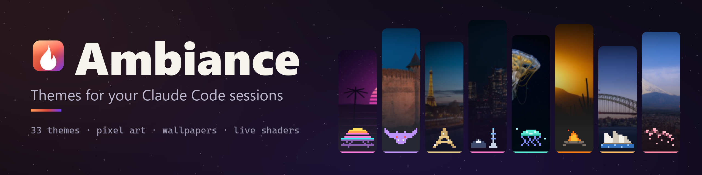

### Give every Claude Code session its own theme, so you always know which one you're typing in.

Colors, a session label, a status line that reacts to your tests and, if you want them, pixel art, wallpapers and live terminal effects.

[](#install)
[](https://github.com/sytem643/claude-code-themes/actions/workflows/plugin.yml)
[](https://github.com/sytem643/claude-code-themes/actions/workflows/app.yml)
[](LICENSE)

**[Install](#install)** · **[Themes](#themes)** · **[Desktop app](#the-desktop-app)** · **[Make your own](#make-your-own)** · **[Contributing](#contributing)**

<br>

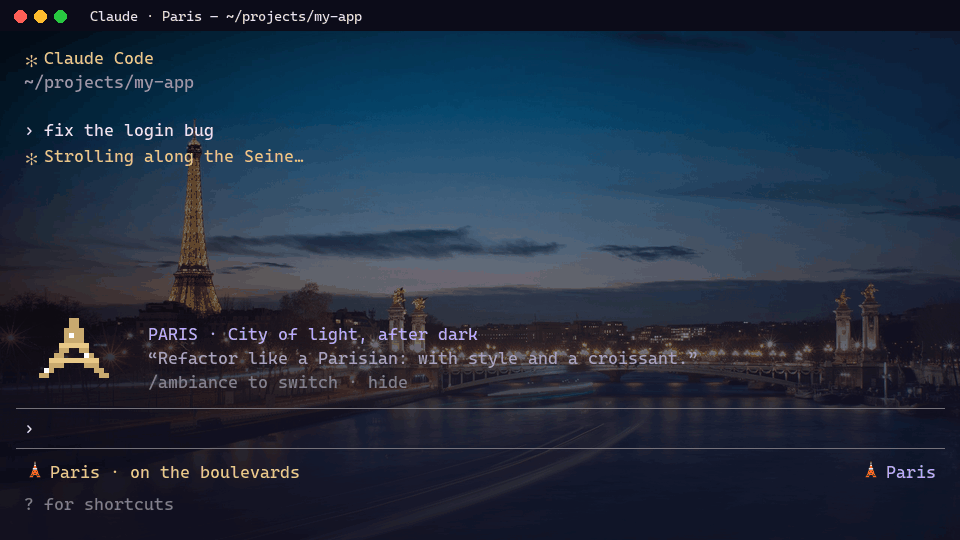

</div>

## Why

You have three Claude Code sessions open: the API, the frontend, production. Same black window, same prompt, same font. Sooner or later you type `drop the test table` in the wrong one.

Ambiance gives each session its own look, so you can tell them apart before you hit Enter:

- **A label in the prompt footer** (`🌆 Synthwave`) and in the status line, so you always know where you are.
- **One theme per project.** Commit a `.ambiance.json` and everyone on the team gets the same theme for that repo. Give production one you can't miss, like `volcano`.
- **A status line that reacts.** A failing test or build turns the session "angry", a passing one "proud". You notice without reading the log.
- **Terminal colors per session**, with a wallpaper and a live effect, when you use the desktop app.

The fun parts are optional. The persona is **off** by default, the pixel art goes away with the `compact` or `minimal` style, and the sounds can be muted.

## Install

```
claude plugin install ambiance --marketplace sytem643/claude-code-themes
```

Then, in any Claude Code session:

```
/ambiance tokyo-night
```

That's the whole plugin. `/ambiance` on its own lists every installed theme.

For terminal colors, wallpapers and effects, switching sessions from one window, project folders and the community gallery, grab the **desktop app** (Windows, macOS, Linux) from the [Releases page](https://github.com/sytem643/claude-code-themes/releases). It's optional: the plugin works without it.

## What a theme changes

| In Claude Code (plugin) | In the terminal (desktop app) |
| --- | --- |
| A session label in the prompt footer | A 16-color palette, cursor and selection colors |
| A status line entry with the current mood | A wallpaper (the theme's, or your own) |
| An animated pixel-art banner above the prompt (`full` style) | A live effect: stars, embers, snow, rain, petals, fireflies, bubbles, digital rain, CRT, glow |
| Themed spinner verbs and end-of-turn line | A ready-made terminal profile per theme |
| Moods when tests or builds fail or pass | Mood sounds on Windows and Linux (Claude Code plays them itself on macOS) |
| An optional persona for Claude's replies | |

<p align="center">
  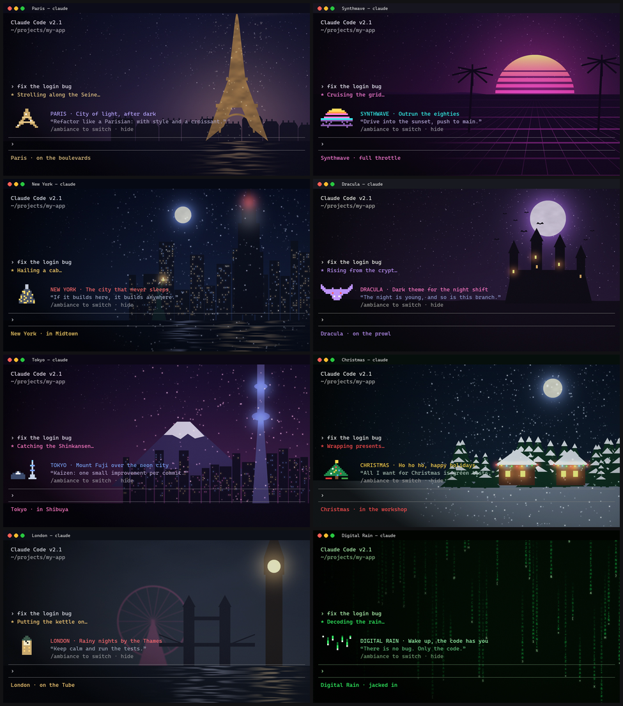
</p>

## Themes

33 themes ship with Ambiance: tributes to the color schemes developers already use, ten cities at night, and originals. Every one has its own pixel art, palette, wallpaper, effect, sounds and texts. The id under each name is what you type after `/ambiance`.

<table>
  <tr>
    <td align="center" width="25%">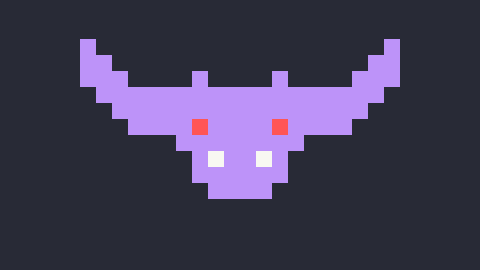<br><b>🧛 Dracula</b><br><code>dracula</code></td>
    <td align="center" width="25%">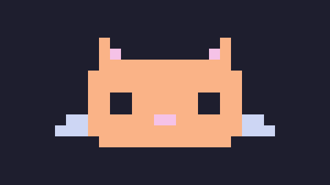<br><b>🐱 Catppuccin</b><br><code>catppuccin</code></td>
    <td align="center" width="25%">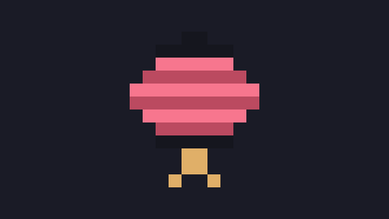<br><b>🏮 Tokyo Night</b><br><code>tokyo-night</code></td>
    <td align="center" width="25%">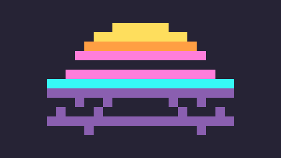<br><b>🌆 Synthwave</b><br><code>synthwave</code></td>
  </tr>
  <tr>
    <td align="center" width="25%">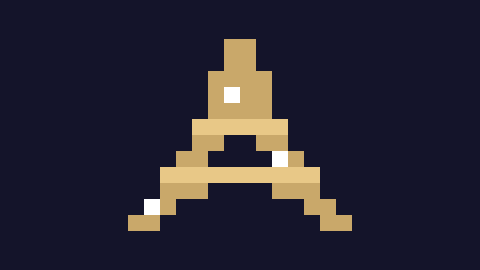<br><b>🗼 Paris</b><br><code>paris</code></td>
    <td align="center" width="25%">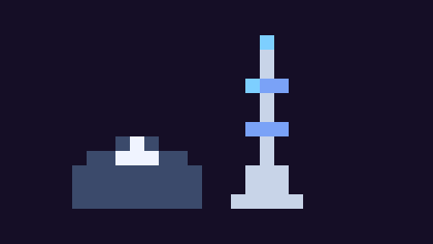<br><b>🗻 Tokyo</b><br><code>tokyo</code></td>
    <td align="center" width="25%">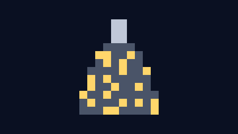<br><b>🗽 New York</b><br><code>new-york</code></td>
    <td align="center" width="25%">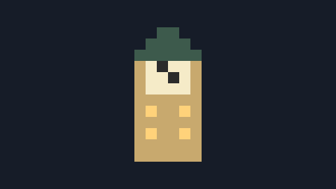<br><b>🎡 London</b><br><code>london</code></td>
  </tr>
  <tr>
    <td align="center" width="25%">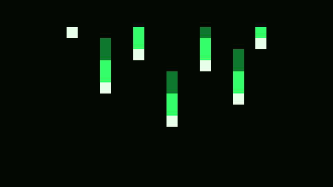<br><b>🟩 Digital Rain</b><br><code>digital-rain</code></td>
    <td align="center" width="25%">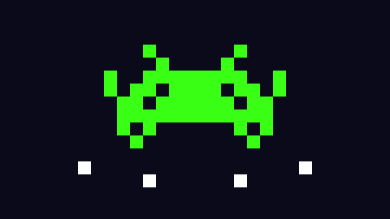<br><b>👾 Arcade</b><br><code>arcade</code></td>
    <td align="center" width="25%">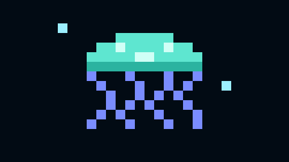<br><b>🪼 Abyss</b><br><code>abyss</code></td>
    <td align="center" width="25%">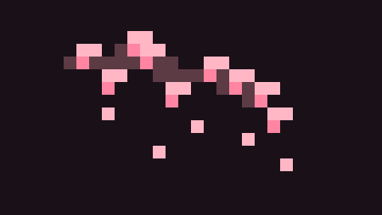<br><b>🌸 Sakura</b><br><code>sakura</code></td>
  </tr>
</table>

<details>
<summary><b>The other 21 themes</b></summary>

<br>

**More palette tributes**

<table>
  <tr>
    <td align="center" width="25%">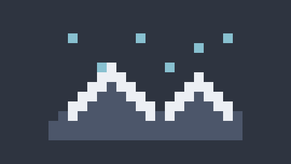<br><b>❄️ Nord</b><br><code>nord</code></td>
    <td align="center" width="25%">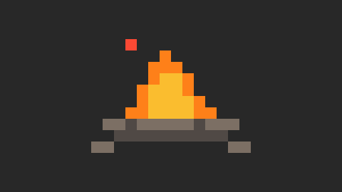<br><b>🌵 Gruvbox</b><br><code>gruvbox</code></td>
    <td align="center" width="25%">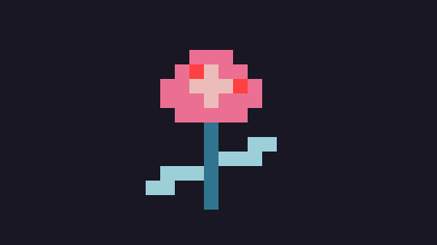<br><b>🌹 Rosé Pine</b><br><code>rose-pine</code></td>
    <td align="center" width="25%">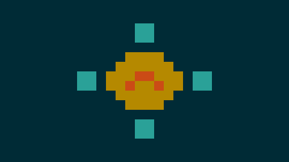<br><b>☀️ Solarized</b><br><code>solarized</code></td>
  </tr>
  <tr>
    <td align="center" width="25%">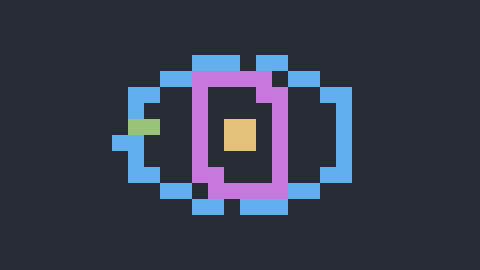<br><b>⚛️ One Dark</b><br><code>one-dark</code></td>
    <td align="center" width="25%">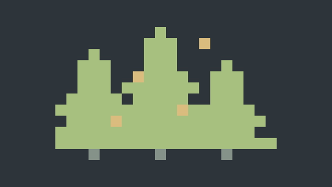<br><b>🌲 Everforest</b><br><code>everforest</code></td>
  </tr>
</table>

**More cities**

<table>
  <tr>
    <td align="center" width="25%">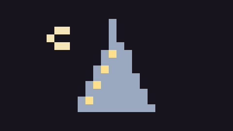<br><b>🌇 Dubai</b><br><code>dubai</code></td>
    <td align="center" width="25%">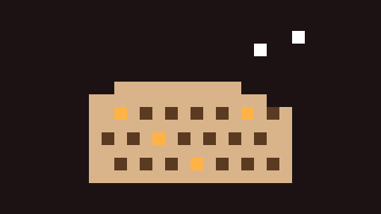<br><b>🏛️ Rome</b><br><code>rome</code></td>
    <td align="center" width="25%">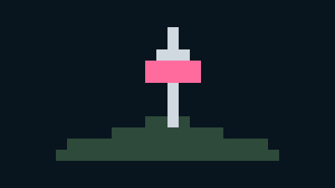<br><b>🏯 Seoul</b><br><code>seoul</code></td>
    <td align="center" width="25%">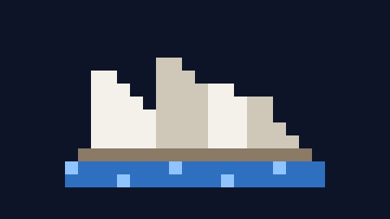<br><b>🦘 Sydney</b><br><code>sydney</code></td>
  </tr>
  <tr>
    <td align="center" width="25%">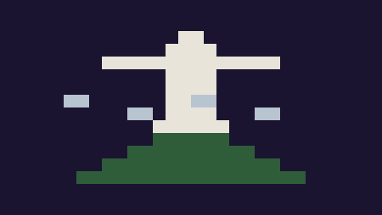<br><b>🌴 Rio de Janeiro</b><br><code>rio</code></td>
    <td align="center" width="25%">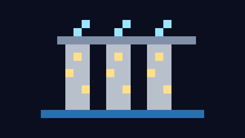<br><b>🌃 Singapore</b><br><code>singapore</code></td>
  </tr>
</table>

**Originals and seasonal**

<table>
  <tr>
    <td align="center" width="25%">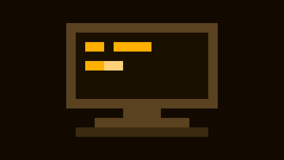<br><b>📟 Phosphor</b><br><code>phosphor</code></td>
    <td align="center" width="25%">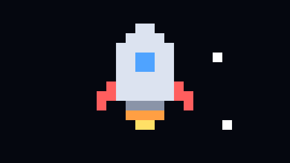<br><b>🚀 Orbit</b><br><code>orbit</code></td>
    <td align="center" width="25%">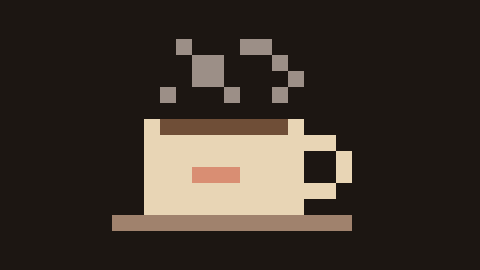<br><b>☕ Lo-fi Café</b><br><code>lofi</code></td>
    <td align="center" width="25%">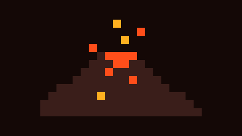<br><b>🌋 Volcano</b><br><code>volcano</code></td>
  </tr>
  <tr>
    <td align="center" width="25%">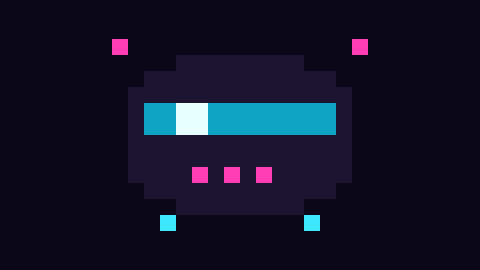<br><b>🌃 Neon 2087</b><br><code>neon-2087</code></td>
    <td align="center" width="25%">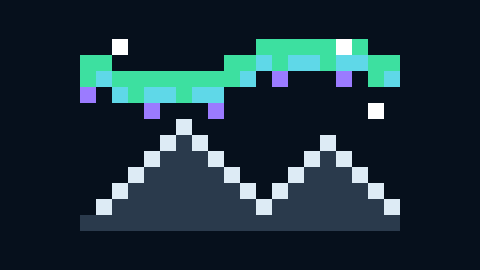<br><b>🌌 Aurora</b><br><code>aurora</code></td>
    <td align="center" width="25%">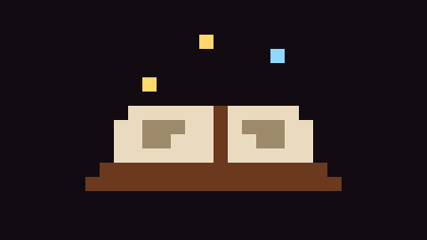<br><b>📜 Grimoire</b><br><code>grimoire</code></td>
    <td align="center" width="25%">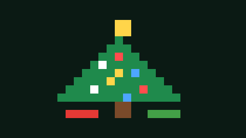<br><b>🎄 Christmas</b><br><code>christmas</code></td>
  </tr>
  <tr>
    <td align="center" width="25%">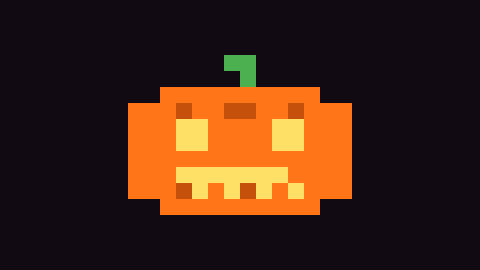<br><b>🎃 Halloween</b><br><code>halloween</code></td>
  </tr>
</table>

</details>

The previews show each theme's pixel art; the screenshot above shows what a full session looks like. Community themes show up in the app's **Discover** tab.

## One theme per session, per project

- **From the app**: the *Sessions* tab lists your open Claude Code sessions. Pick a theme for any of them and the banner, status line and spinner switch within a couple of seconds. Terminal colors and wallpaper apply to new sessions.
- **Per project**: put a `.ambiance.json` at the root of your repository (a parent folder works too):

  ```json
  { "theme": "dracula" }
  ```

  Or link a folder to a theme in the app's *Projects* tab.
- **At launch**: `CLAUDE_THEME=nord claude`.

When several apply, the first one wins: the theme the app assigned to the session, then `CLAUDE_THEME`, then the project (`.ambiance.json`, then the app's project links), then the default theme.

## Three styles

| Style | What you get |
| --- | --- |
| `full` (default) | Animated pixel-art banner above the prompt, themed spinner and end-of-turn line, mood sounds |
| `compact` | A one-line banner, themed spinner and end-of-turn line |
| `minimal` | Just the session label, the status line and the terminal colors |

Switch with `/ambiance style minimal`, or in the app's *Settings*. The persona is opt-in (`/ambiance persona on`). Sounds come with the `full` style; `/ambiance sounds off` mutes them, `/ambiance sounds on` keeps them in the other styles.

<details>
<summary><b>All <code>/ambiance</code> commands</b></summary>

```
/ambiance                        list the themes and the current settings
/ambiance <theme>                switch this session to a theme
/ambiance off                    remove the theme from this session
/ambiance style full|compact|minimal
/ambiance persona on|off         Claude's tone (off by default)
/ambiance sounds on|off          mood sounds (on in the full style)
/ambiance companion              animated companion in a side panel
/ambiance banner                 hide or show the banner in every session
```

The *hide* button on the banner only hides it in the current session. Style, persona, sounds and banner are saved in `~/.ambiance/config.json`, shared with the app, and open sessions pick up changes within two seconds.

</details>

<details>
<summary><b>Plugin options</b></summary>

The plugin declares these options in [`plugin/.claude-plugin/plugin.json`](plugin/.claude-plugin/plugin.json). Anything you set with `/ambiance` or in the app takes precedence.

| Option | Default | What it does |
| --- | --- | --- |
| `defaultTheme` | empty | Theme for sessions with no other theme (an id such as `dracula`) |
| `style` | `full` | `full`, `compact` or `minimal` |
| `persona` | `false` | Adds the theme's tone to Claude's replies |
| `banner` | `true` | Shows the banner above the prompt |
| `sounds` | `false` | Plays mood sounds in every style, not only `full` |

</details>

## The desktop app

The app is a small Tauri window that sits in your tray. Its tabs:

- **Sessions**: your open Claude Code sessions, with their folder, theme and current mood. Switch any of them live.
- **Themes**: every installed theme. *Customize* lets you change the wallpaper (one of the theme's, or your own image or GIF), its opacity and the animated effect, or turn the effect off.
- **Discover**: the community gallery, one click to install.
- **Create**: describe a vibe, get a complete theme (see below).
- **Projects**: link a folder to a theme; Claude Code opens there in that theme.
- **New session**: open Claude Code in a folder, in a terminal that's already themed.
- **Settings**: default theme, style, persona, sounds, and an *Update* button that rewrites the terminal profiles.

<details>
<summary id="platforms"><b>Platforms and terminals</b></summary>

<br>

| System | Colors and wallpaper written for | Animated effects | *New session* opens in |
| --- | --- | --- | --- |
| Windows | Windows Terminal (one profile per theme, through a settings fragment) | Windows Terminal (HLSL) | Windows Terminal, or a plain console without the colors |
| macOS | iTerm2 (dynamic profiles), Ghostty (theme files) | Ghostty (GLSL) | iTerm2, else Ghostty, else Terminal.app |
| Linux | Ghostty (theme files), kitty (options at launch) | Ghostty (GLSL) | The first one installed: Ghostty, kitty, WezTerm, Alacritty, GNOME Terminal, Konsole, Xfce Terminal, then `x-terminal-emulator` |

On Linux, Alacritty gets the theme's background and foreground colors; WezTerm, GNOME Terminal, Konsole and Xfce Terminal open with their own colors. The plugin side (label, status line, banner, moods, persona) works in any terminal Claude Code runs in. In macOS Terminal.app the pixel art is approximated because it lacks 24-bit color; iTerm2 or Ghostty give the full result.

For everything that can and can't be customized in a Claude Code terminal, and why some parts are left alone, see [docs/CUSTOMIZATION.md](docs/CUSTOMIZATION.md).

</details>

## Make your own

- **With AI**: in the app's *Create* tab, describe a vibe ("abandoned space station, red alarms"). Claude designs the whole theme, pixel art included, through your own Claude Code (`claude -p`, no API key). The app then checks the result and fixes any color that would be hard to read.
- **By hand**: a theme is one `theme.json` plus optional wallpapers and sounds. [CONTRIBUTING.md](CONTRIBUTING.md) walks through every field, and [docs/theme.schema.json](docs/theme.schema.json) gives you completion and validation in VS Code. Drop the folder in `~/.ambiance/themes/` and run `/ambiance <id>`.
- **Your own wallpaper**: in *Themes > Customize*, pick any image. A still image is cropped to 16:9, softened, tinted with the theme's colors and darkened where the text goes; an animated GIF is kept as is and blended in with the opacity slider. The image stays on your computer.

Happy with it? *Submit to the gallery* copies your `theme.json` and opens the [Submit a theme](https://github.com/sytem643/claude-code-themes/issues/new?template=theme.yml) form on GitHub.

## FAQ

<details>
<summary><b>Does it touch my code or my files?</b></summary>

<br>

No. The plugin reads themes and your project's `.ambiance.json`, and only writes to `~/.ambiance/` (the session's theme and mood, and your preferences). It watches the commands Claude runs to spot tests and builds, but read-only: nothing is blocked or changed. The persona, when on, comes with rules that forbid theme references in code, names, comments, commit messages, files and commands.

The desktop app writes its own terminal files: a Windows Terminal fragment, an iTerm2 dynamic profile (`ambiance.json`) and Ghostty theme files (`ambiance-<id>`). It doesn't edit your existing terminal settings.

</details>

<details>
<summary><b>Does it cost tokens or slow Claude Code down?</b></summary>

<br>

With the persona off (the default), Ambiance adds nothing to what is sent to the model: the banner, label, status line and spinner are interface only. With the persona on, one short section is added to the system prompt: the theme's tone (one to three sentences) plus six fixed rules, around 600 characters for the bundled themes.

The banner animates at 4 frames per second by repainting only its own cells. The plugin checks two small JSON files every two seconds (theme assignment and preferences) and writes a heartbeat every five. The terminal effects run as shaders inside the terminal; you can turn them off per theme in *Customize*.

</details>

<details>
<summary><b>Which terminals are supported?</b></summary>

<br>

The plugin part works wherever Claude Code runs. The terminal part (colors, wallpaper, effects) is for Windows Terminal on Windows, iTerm2 and Ghostty on macOS, and Ghostty and kitty on Linux. Animated effects need Windows Terminal or Ghostty. Details in [Platforms and terminals](#platforms).

</details>

<details>
<summary><b>Do I need the desktop app?</b></summary>

<br>

No. The plugin alone gives you the label, status line, banner, spinner, moods, persona and the `/ambiance` command. The app adds terminal colors, wallpapers and effects, live switching from one window, project links, the gallery, the theme generator, and the mood sounds on Windows and Linux.

</details>

<details>
<summary><b>What does the AI theme generator use?</b></summary>

<br>

Your local Claude Code, run as `claude -p` with the `sonnet` model (set `AMBIANCE_GEN_MODEL` to use another one). It counts toward your usual Claude Code usage and needs no API key.

</details>

<details>
<summary><b>Is this an official Anthropic project?</b></summary>

<br>

No. Ambiance is an unofficial community project and is not affiliated with or endorsed by Anthropic.

</details>

## Contributing

The easiest way to help is to **share a theme**. Make one in the app or by hand, then either open a pull request with your `plugin/themes/<id>/` folder or paste your `theme.json` into the [Submit a theme](https://github.com/sytem643/claude-code-themes/issues/new?template=theme.yml) form. Pull requests are checked automatically: JSON shape, text contrast, pixel art, file types and sizes. The gallery rules are short: original art and texts, no official logos or images, and a kind persona.

Bug reports, new terminal support and engine fixes are welcome too. [CONTRIBUTING.md](CONTRIBUTING.md) explains the theme format, the engine and the app. Please follow the [code of conduct](CODE_OF_CONDUCT.md), report vulnerabilities privately as described in [SECURITY.md](SECURITY.md), and see [CHANGELOG.md](CHANGELOG.md) for what changed between versions.

If Ambiance saved you from typing in the wrong session, a star helps other people find it.

<details>
<summary><b>Build from source</b></summary>

```
cd app
npm install
npm run tauri dev      # development
npm run tauri build    # installers
```

You need Node 20+ and stable Rust, plus the Visual Studio C++ build tools on Windows, the Xcode command line tools on macOS, or `libwebkit2gtk-4.1-dev libayatana-appindicator3-dev librsvg2-dev` on Linux.

The bundled themes are generated by the scripts in `scripts/art/`: `collection.py` builds the palette tributes, cities and most originals, `originals.py` builds Neon 2087, Aurora and Grimoire, and `photos.py` downloads and grades the photo wallpapers. `scripts/build_shaders.py` writes the effects (HLSL and GLSL), and `scripts/build_gallery.py --check` runs the same checks as CI.

</details>

## Credits and license

The palette tributes use the color values of their original MIT-licensed projects. Most wallpapers are photographs from Wikimedia Commons, color-graded for the terminal and shared under their own licenses (public domain, CC0, CC BY, CC BY-SA); every author is credited in [docs/CREDITS.md](docs/CREDITS.md). The pixel art, the painted scenes and the sounds are original.

The code is under the [MIT license](LICENSE). The wallpaper photographs keep their original licenses, listed in [docs/CREDITS.md](docs/CREDITS.md).

Ambiance is an unofficial community project, not affiliated with Anthropic. Claude and Claude Code are trademarks of Anthropic.
